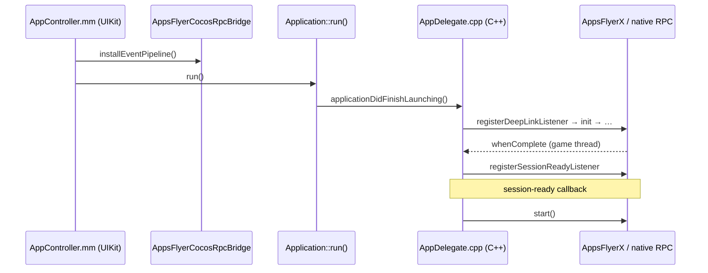

# Cocos2d-x lifecycle and AppsFlyer SDK 7

Integrator flow for **schema-generated** `AppsFlyerX` (`AppsFlyerTask` + `whenComplete`). Upgrading from **plugin 6.x**? See [Migration-Guide.md](Migration-Guide.md) for packaging and API changes.

**Platforms:** Android and iOS only ([`CHANGELOG.md`](../CHANGELOG.md)).

---

## 1. Native entry hooks

| Platform | Hook |
|----------|------|
| **Android** | `AppActivity.onCreate` → `AppsFlyerCocosRpcBridge.onActivityCreated(this)` **before** `super.onCreate()` |
| **iOS** | `AppController` → `[AppsFlyerCocosRpcBridge installEventPipeline]` **before** `Application::run()` |

iOS file copy, SwiftPM, checklist, and Xcode settings: [iOS-README.md](iOS-README.md).

### iOS startup timeline (Cocos2d-x)

Two layers run in order — native (UIKit) first, then Cocos game code:

- **`installEventPipeline`** must run **before** `run()` so inbound `rpcEvent` callbacks can reach C++.
- **`init` / `start`** run later on the **game thread** inside `applicationDidFinishLaunching()` (not in `AppController.mm`).
- Minimal C++ example: [`snippets/ios-minimal-init.cpp`](snippets/ios-minimal-init.cpp) (full QA: `Classes/AppDelegate.cpp`).

---

## 2. Recommended startup order (sample: `Classes/AppDelegate.cpp`)

On the **game thread** during `applicationDidFinishLaunching()`:

1. Optional schema calls (`stop`, `setPartnerData`, …).
2. **`registerDeepLinkListener`** → **`enableDebug(true)`** → **`init(InitParams)`** (nested `whenComplete`).
3. **`registerConversionListener`** → **`registerSessionReadyListener`**.
4. In session-ready callback → **`start(awaitResponse)`** / **`logEvent`**.

Use **`registerDeepLinkListener`**, **`registerConversionListener`**, and **`registerSessionReadyListener`** — not ad hoc listener setters outside the generated API.

**Internal:** `setPluginInfo` runs automatically on the worker immediately before the first `init` / `initialize` RPC.

---

## 3. Threading

| Path | Rule |
|------|------|
| Outbound RPC | Worker `std::thread` → blocking native bridge |
| `AppsFlyerTask.whenComplete` | Always on **game thread** |
| Inbound `rpcEvent` | Native → bridge → `AppsFlyerRpc` → game thread → app callbacks |

---

## 4. Events

Native emits JSON on `rpcEvent`. C++ demuxes by top-level `"event"` and parses `"data"` into:

- Conversion success/fail → `cocos2d::ValueMap`
- Deep link → `appsflyer::DeepLinkData` (`status` → FOUND / NOT_FOUND / ERROR, optional `error`, `deepLink` map)

---

## 5. Limitations

- **GAP-010:** No iOS cold-start attribution queue / `handleOpenURL` RPC glue in-plugin.
- **GAP-007:** Android RPC Kotlin remains in the sample app module (not a published AAR).
- **Android warm-start deep links:** sample `AppActivity` uses `onNewIntent` + `setIntent` only; cold-start / iOS URL forwarding is still integrator-owned where noted in platform READMEs.
- Nested JSON in event payloads may require future parser hardening.

---

## 6. File map

| Concern | Location |
|---------|----------|
| Sample chain | `Classes/AppDelegate.cpp` |
| Public API | `Classes/AppsFlyer/AppsFlyerX.h` + `generated/*` |
| Transport | `Classes/AppsFlyer/AppsFlyerRpc.{h,cpp}` |
| Codegen | `schema/`, `scripts/codegen/run.sh`, `tools/af-schema-compiler/` |
| Android bridge | `proj.android-studio/.../AppsFlyerCocosRpcBridge.kt` |
| iOS bridge | `proj.ios_mac/ios/rpc/AppsFlyerCocosRpcBridge.*` |