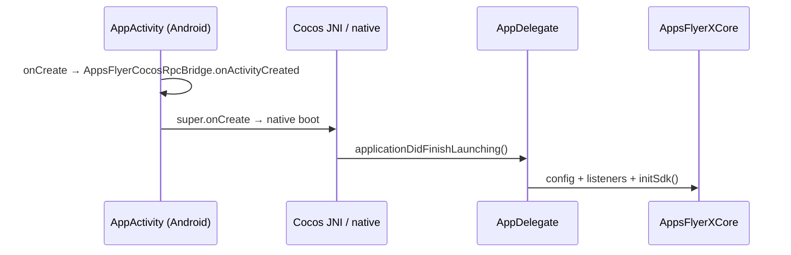
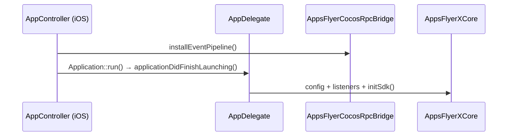
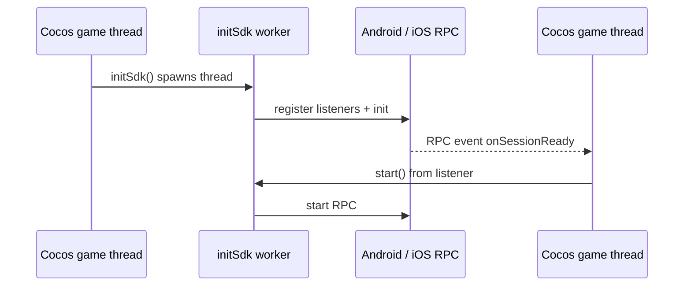

# Cocos2d-x lifecycle and AppsFlyer SDK 7 execution (Phase 1)

This document describes how the **sample app** wires Cocos2d-x platform lifecycle to the **SDK 7 RPC** spine (`AppsFlyerX` → `AppsFlyerXCore` → native RPC). Integrators should mirror these hooks in their own `AppDelegate` and platform entry classes.

**Supported platforms:** Android and iOS only (see `CHANGELOG.md`).

---

## 1. Where Cocos2d-x starts

| Platform | Native entry | When `AppDelegate::applicationDidFinishLaunching()` runs |
|----------|----------------|-----------------------------------------------------------|
| **Android** | `AppActivity` → Cocos `NativeActivity` / JNI | After `AppActivity.onCreate()` (Activity context is set **before** `super.onCreate()`). |
| **iOS** | `AppController` → `Application::run()` | After GL view is attached to the window; `app->run()` calls into Cocos and eventually `applicationDidFinishLaunching()`. |

**iOS note:** `installEventPipeline()` runs in `AppController` **before** the C++ launch path. That registers the Swift → C++ event bus so RPC callbacks can reach the game thread once `initSdk()` runs.

**Android note:** The event bus is attached in `AppsFlyerCocosRpcBridge`’s Kotlin `init` block; Activity context is required before the first blocking RPC from C++.

---

## 2. Sample startup order (`Classes/AppDelegate.cpp`)

Everything in this section runs on the **Cocos main / game thread** during `applicationDidFinishLaunching()`, **before** `Director::runWithScene()` (unless noted).

| Step | API call | Effect in Phase 1 |
|------|----------|-------------------|
| 1 | `AppsFlyerX::setIsDebug(true)` | Stores debug flag; applied on the init worker as RPC `isDebug` (if set before `initSdk()`). |
| 2 | `setAppsFlyerDevKey(...)` | Stores dev key in `AppsFlyerXCore` (used by `init` RPC). |
| 3 | `setAppleAppID(...)` (iOS only) | Stores App Store app id (required for iOS `init` RPC). |
| 4 | `setOnConversionDataSuccess` / `Fail` | Registers C++ callbacks; causes `initSdk()` to call `registerConversionListener`. |
| 5 | `setOnAppOpenAttribution` / `Failure` | Registers callbacks in sample; **RPC not wired** in Phase 1 (`AppsFlyerXCore` stubs). |
| 6 | `setDidResolveDeepLink(...)` | Registers deep link callback; causes `subscribeForDeepLink` (Android) or `registerDeeplinkListener` (iOS). |
| 7 | `setPartnerData(...)` | Sample only; **no-op** in Phase 1 (`AppsFlyerXCore` stub). |
| 8 | `registerSessionReadyListener(onSessionReadyStartSdk)` | Registers callback that calls `AppsFlyerX::start()` when session-ready fires. |
| 9 | `initSdk()` | Starts **detached worker thread**; see §3. |

After step 9, the sample continues with normal Cocos setup (GL view, scene, `runWithScene`). SDK work does **not** block the game thread except for brief JNI/Swift entry from the worker.

---

## 3. What `initSdk()` does (worker thread)

`initSdk()` uses `runOnWorker()` — a **detached `std::thread`** — so RPC does not block Cocos’s main thread.

On that worker, `AppsFlyerXCore` runs **in order** (only if the matching listener was registered):

1. Deep link listener registration (`subscribeForDeepLink` / `registerDeeplinkListener`)
2. `registerConversionListener` (if success or fail conversion callback set)
3. `registerSessionReadyListener` (if session-ready callback set)
4. `setPluginInfo` (`cocos2dx` / `7.0.0-poc`)
5. `isDebug` (if `setIsDebug` was called earlier)
6. `init` with `devKey` (+ `appId` on iOS)

Each step is a **blocking RPC** (`AppsFlyerRpcClient::executeBlocking`):

- **Android:** JNI → `AppsFlyerCocosRpcBridge.executeRpcBlocking` → Kotlin executor → `AppsFlyerRpcHandler`
- **iOS:** C++ → `executeRpcBlockingRequest` → Swift `AppsFlyerCocosRpcBridge` → `AppsFlyerRPC`

**Manual start:** The sample does **not** call `start()` in `applicationDidFinishLaunching()`. It waits for the **`onSessionReady`** event, then the session-ready listener calls `AppsFlyerX::start(true, onComplete)` so the dialog reflects schema **`awaitResponse`** (blocking RPC on a worker, completion on the game thread).

---

## 4. Events: native → game thread

1. Native SDK emits JSON events to the plugin bridge.
2. **Android:** Kotlin → `nativeDeliverRpcEvent` → `onNativeRpcEventFromBridge`.
3. **iOS:** Swift event bus → `AppsFlyerCocosRpcNativeDeliverEvent` → same C++ path.
4. `AppsFlyerRpcClient` forwards to `AppsFlyerCocosThread::runOnGameThread` (`Director::Scheduler::performFunctionInCocosThread`).
5. `AppsFlyerXCore` maps event types and invokes your C callbacks:

| Event `event` field | Sample callback |
|---------------------|-----------------|
| `onSessionReady` | `registerSessionReadyListener` → `start()` |
| `onConversionDataSuccess` | `setOnConversionDataSuccess` (Phase 1: empty `ValueMap`) |
| `onConversionDataFail` | `setOnConversionDataFail` (Phase 1: empty `ValueMap`) |
| `onDeepLinking` | `setDidResolveDeepLink` (Phase 1: minimal `FOUND` stub) |

**Important:** Register listeners **synchronously before `initSdk()`** on the game thread so the worker sees non-null callbacks and native listener registration runs during the init batch.

**Start / logEvent completion (schema):** There is no `setOnRequestResponse` in the RPC schema. Use the method parameter **`awaitResponse: true`** on `start` / `logEvent` (same as Flutter/Capacitor). The sample passes an `onComplete` callback; `AppsFlyerXCore` runs it on the **game thread** after the blocking RPC returns.

---

## 5. Foreground / background

| Cocos hook | Sample behavior | SDK 7 Phase 1 |
|------------|-----------------|-----------------|
| `applicationDidEnterBackground()` | Stops director animation; `AppsFlyerX::didEnterBackground()` | **Android:** forwarded to `appsflyer::didEnterBackground()` (stub). **iOS:** no-op in sample path. |
| `applicationWillEnterForeground()` | Resumes animation / audio only | No AppsFlyer calls in sample. |

There is no automatic `start()` on resume in the sample; session handling is driven by SDK 7 session-ready + your explicit `start()`.

---

## 6. Later API calls (e.g. `logEvent`)

Any RPC API that uses `runOnWorker()` in `AppsFlyerXCore` (e.g. `start()`, `logEvent()`) follows the same pattern:

- Called from **game thread** (typical).
- Work runs on a **short-lived detached thread**.
- Blocking RPC on Android/iOS bridge (do not call blocking RPC from the Android **main** thread from Kotlin’s perspective; C++ worker is fine).

---

## 7. Integrator checklist

1. **Android:** Call `AppsFlyerCocosRpcBridge.onActivityCreated(this)` at the start of `onCreate`, before `super.onCreate()`.
2. **iOS:** Call `[AppsFlyerCocosRpcBridge installEventPipeline]` before Cocos `Application::run()` (see `AppController.mm`).
3. In `applicationDidFinishLaunching()`, on the game thread:
   - Set `devKey` (and **iOS** `appId`).
   - Optional: `setIsDebug` **before** `initSdk()`.
   - Register conversion / deep link / session-ready listeners.
   - `registerSessionReadyListener` → `start()` (manual start pattern).
   - Call `initSdk()` once.
4. Do **not** rely on Phase 1 stubs: `setPartnerData`, app-open attribution, full conversion/deep-link payloads (see §8).

---

## 8. Phase 1 limitations (execution / data)

These affect **what** runs, not just **when**:

- Many `AppsFlyerX` methods map to **empty stubs** in `AppsFlyerXCore.cpp` (no RPC).
- Conversion and deep-link callbacks fire on the game thread but **payload parsing is not implemented** (empty or placeholder `ValueMap` / `AppsFlyerXDeepLinkResult`).
- **iOS cold start:** Registering session-ready before `init` can fail on device if native requires `init` first; reordering is planned for a later phase (register listeners without RPC pre-init, then `init`, then native start when session-ready).

For the authoritative RPC method list and platform differences, use the generated schema / `js-core-plugin` contract shared with other AppsFlyer mobile plugins.

---

## 9. File map

| Concern | Location |
|---------|----------|
| Sample call order | `Classes/AppDelegate.cpp` |
| Init batch + listeners | `Classes/AppsFlyer/AppsFlyerXCore.cpp` |
| Public API | `Classes/AppsFlyer/AppsFlyerX.h` / `AppsFlyerX.cpp` |
| RPC + game thread | `Classes/AppsFlyer/rpc/AppsFlyerRpcClient.cpp`, `AppsFlyerCocosThread.cpp` |
| Android Activity hook | `proj.android-studio/app/src/org/cocos2dx/cpp/AppActivity.java` |
| Android RPC | `proj.android-studio/app/src/main/kotlin/.../AppsFlyerCocosRpcBridge.kt` |
| iOS pipeline install | `proj.ios_mac/ios/AppController.mm` |
| iOS RPC | `proj.ios_mac/ios/rpc/*` |
