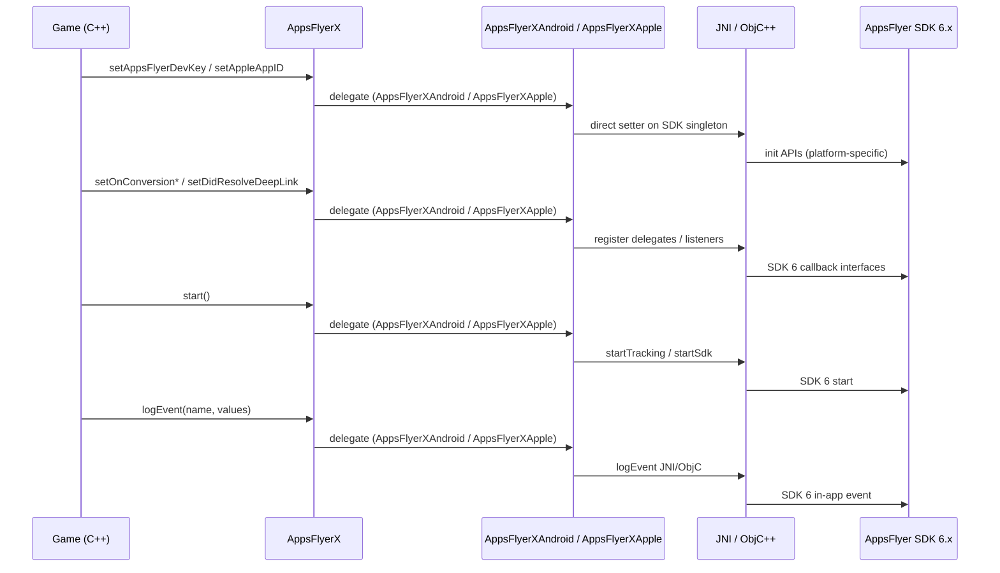
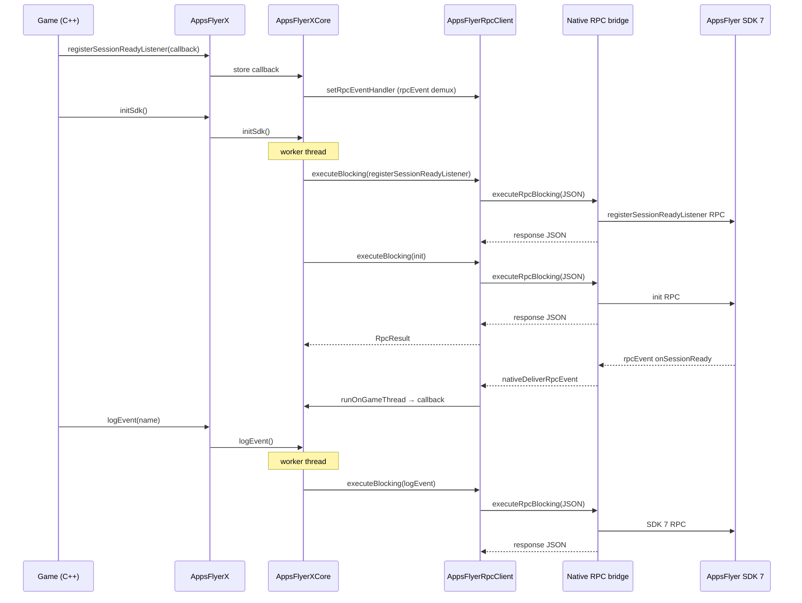

# Tech design — Phase 1: SDK 7 + RPC spine (PR1)

| Field | Value |
| --- | --- |
| **Document type** | Technical design (Phase 1) |
| **Epic** | [DELIVERY-132096](https://appsflyer.atlassian.net/browse/DELIVERY-132096) |
| **Feature branch** | `DELIVERY-132096-sdk7-rpc` |
| **Phase 1 branch (PR1)** | `DELIVERY-132096-sdk7-rpc-phase1-poc` (rename from `DELIVERY-133719-sdk7-rpc-phase1-poc` if still on remote) |
| **Status** | Published to [Notion (Phase 1 PR1)](https://app.notion.com/p/appsflyerrnd/Phase-1-SDK-7-RPC-spine-PR1-40cb7b13af5f81378541ed80412139fa); keep repo copy in sync on design changes |
| **Repo** | `appsflyer-cocos2dx-plugin` |

This document is the **authoritative tech design for Phase 1**. The Notion page is the published copy for stakeholders after approval; keep both in sync when the design changes.

---

## 1. Goals

1. **Replace the SDK 6 native bridge** on Android and iOS with the **SDK 7 JSON RPC spine** (`plugin-bridge` / `AppsFlyerRPC`).
2. **Preserve the public `AppsFlyerX` C++ API** for Phase 1 — no integrator-facing API break; only the implementation path changes on mobile.
3. **Prove end-to-end** on the sample app: config → listener registration → `initSdk` → session-ready event → `start` → `logEvent`.
4. **Establish build/integration patterns** (CMake + Gradle BOM/bridge on Android; CMake + CocoaPods workspace on iOS).

### Success criteria

- Android: `:app:assembleDebug` green; init/start/logEvent and RPC events visible in logcat (`[AF-SDK7]`).
- iOS: Simulator/device build via **`.xcworkspace`** green; same flow in console.
- No linkage of legacy `AppsFlyerXAndroid.cpp` / SDK 6 iOS ObjC++ path on **mobile** CMake targets.
- Single C++ dispatch path: `AppsFlyerX` → `AppsFlyerXCore` → `AppsFlyerRpcClient` → one native `executeRpcBlocking` entry per platform.

---

## 2. Non-goals (Phase 1)

| Item | Deferred to |
| --- | --- |
| Full `AppsFlyerX` surface over RPC (most methods remain **stubs** in `AppsFlyerXCore`) | Phase 2 (schema + codegen) |
| Rich JSON parsing / typed event payloads in C++ | Phase 2 |
| Reusable Android AAR / shipped integrator package layout | Phase 1 PR hardening / Phase 3 |
| Cocos Creator plugin packaging | Separate product |
| iOS attribution queue (cold-start deep links before bridge ready) | Phase 1 follow-up (GAP-010) |
| **RPC synchronization to the game** (per-call native completion, error propagation, listener rollback) | Phase 2 — [`PHASE2-TECH-DESIGN.md`](./PHASE2-TECH-DESIGN.md) |

---

## 3. Background

The Cocos2d-x plugin historically implemented **one native call per feature** in `AppsFlyerXAndroid.cpp` and `AppsFlyerXApple.mm`, targeting **SDK 6**. Upgrading the Android Maven artifacts to **SDK 7** without replacing JNI caused **init crashes** (e.g. missing `com.appsflyer.internal.platform_extension.PluginInfo`).

SDK 7 exposes a **single RPC channel** to host apps: `{ "method", "params" }` in, `{ "success", "data" \| "error" }` out, with persistent listener events on a shared **`rpcEvent`** channel — implemented in **`af-android-plugin-bridge`** (Android) and **`AppsFlyerRPC`** (iOS).

Phase 1 adopts that spine in C++ while keeping `AppsFlyerX` as the game-facing façade.

---

## 4. Architecture

### 4.1 Comparison (before vs after)

| Before (SDK 6) | After (Phase 1) |
| --- | --- |
| `AppsFlyerX` → `AppsFlyerXAndroid` / `AppsFlyerXApple` → many JNI/ObjC entry points | `AppsFlyerX` → **`AppsFlyerXCore`** (`namespace appsflyer`) → **`AppsFlyerRpcClient`** → **one** `executeRpcBlocking` |
| Android `PluginInfo` JNI | **`af-android-plugin-bridge`** + Kotlin `AppsFlyerRpcHandler` |
| iOS static SDK 6 + helpers | **CocoaPods** `AppsFlyerRPC` + Swift façade |
| Per-method native maintenance | Wire names aligned with shared RPC schema (manual in Phase 1) |

### 4.2 Layer diagram

```
Game (C++)
    AppsFlyerX.cpp          — public API; platform #if only where semantics differ (iOS-only APIs, etc.)
    AppsFlyerXCore.cpp      — config, listeners, Phase 1 RPC orchestration, Phase 1+ stubs
    rpc/AppsFlyerRpcClient  — JSON envelope, blocking call, rpcEvent → game thread
         │
         ├─ Android: JNI → AppsFlyerCocosRpcBridge.kt → AppsFlyerRpcHandler
         └─ iOS:     ObjC++ → AppsFlyerCocosRpcBridge.swift → AppsFlyerRPCBridge
                              │
                              AppsFlyer SDK 7
```

**Mobile CMake:** does **not** link `AppsFlyerXAndroid.cpp` or legacy iOS `AppsFlyerXApple.mm`. **macOS** desktop target may still link legacy Apple sources (non-mobile; out of Phase 1 RPC scope).

### 4.3 Design decisions

| ID | Decision | Rationale |
| --- | --- | --- |
| D1 | Single RPC entry per platform (`executeRpcBlocking`) | One JNI/ObjC++ boundary; avoids per-method native glue |
| D2 | Blocking RPC from **worker `std::thread`**, not GL thread | Prevents ANR/jank; events still delivered on cocos thread |
| D3 | Phase 1 keeps C function-pointer listeners on `AppsFlyerX` | No API break; event demux in core by `event` string field |
| D4 | Android deep link wire: `subscribeForDeepLink`; iOS: `registerDeeplinkListener` | Platform RPC map difference encapsulated in `AppsFlyerXCore` |
| D5 | iOS build = CMake **+** Pods **workspace** | `AppsFlyerRPC` is a Pod, not vendored in repo |
| D6 | Plugin id `cocos2dx` in `setPluginInfo` | Placeholder until bridge enum approval |
| D7 | Phase 1 listener setters are **in-memory only**; native `register*Listener` wires run inside **`initSdk()`** worker batch | Spine validation only; **not** the SDK 7 integrator contract (Phase 2) |

---

## 5. Call flows (selected Phase 1 methods)

**In scope for wire validation:** configuration (`setAppsFlyerDevKey`, `setAppleAppID`, `setIsDebug`), listener registration (`setOnConversion*`, `setDidResolveDeepLink`, `registerSessionReadyListener`), `initSdk`, `start`, `logEvent`.

Other `AppsFlyerX` methods call **`AppsFlyerXCore` stubs** (no RPC) until Phase 2.

### 5.1 Pre–Phase 1 (SDK 6)



### 5.2 Post–Phase 1 (SDK 7 RPC)

Simplified spine (three public calls). Dev key / app id and other RPC steps in `initSdk()` are omitted here; see §5.3.



### 5.3 RPC wire mapping (Phase 1 spike)

**POC note:** `initSdk()` currently batches several wire calls (listener registration, `setPluginInfo`, `isDebug`, `init`) inside `AppsFlyerXCore` to validate the spine quickly. That bundling is **not** the long-term design. In later phases, each SDK 7 init/setup method is exposed on `AppsFlyerX` (or generated API) and the **app owns call order**.

| Trigger | RPC method(s) | Notes |
| --- | --- | --- |
| Deep link callback set before `initSdk` | `subscribeForDeepLink` (Android) / `registerDeeplinkListener` (iOS) | Skipped if callback null |
| Conversion callbacks set | `registerConversionListener` | Payload → empty `ValueMap` in POC |
| `registerSessionReadyListener` | `registerSessionReadyListener` | Sample: callback calls `start()` |
| `setIsDebug` before init | `isDebug` | Buffered until `initSdk` worker |
| `initSdk` | `setPluginInfo`, `init` | `plugin`: `cocos2dx`, `pluginVersion`: `7.0.0-poc`; init JSON platform-specific |
| `start` | `start` | `awaitResponse: false` |
| `logEvent` | `logEvent` | `eventValues` empty object in Phase 1 |

### 5.4 Sample app order (Phase 1 POC only)

The sample `Classes/AppDelegate.cpp` uses SDK 7 manual start for end-to-end testing:

1. `setIsDebug`, `setAppsFlyerDevKey`, `setAppleAppID` (iOS)
2. Register conversion / deep link / attribution callbacks
3. `registerSessionReadyListener` → invoke `AppsFlyerX::start()` from that callback
4. `initSdk()` (POC: triggers bundled RPC sequence inside core)

Integrators should treat this as **spike/demo ordering**, not a permanent contract. Later phases document per-method APIs and leave **init sequencing to the app**.

**Phase 1 limitation:** Public listener methods (`setOnConversion*`, `setDidResolveDeepLink`, `registerSessionReadyListener`) do **not** issue native RPC at call time and do **not** report success or failure to the game. If `initSdk()` runs before a listener is registered, that listener’s native wire may never run. This is **not** supported as a long-term synchronization model — see §8.1.

---

## 6. Components & interfaces

### 6.1 C++

| File | Responsibility |
| --- | --- |
| `Classes/AppsFlyer/AppsFlyerX.cpp` | Public static API |
| `Classes/AppsFlyer/AppsFlyerXCore.cpp` | Mobile implementation + stubs |
| `Classes/AppsFlyer/rpc/AppsFlyerRpcClient.cpp` | `executeBlocking`, `setRpcEventHandler`, platform JNI/ObjC++ |
| `Classes/AppsFlyer/rpc/AppsFlyerCocosThread.cpp` | Post events to cocos game thread |

**Request shape (C++ → native):** `{"method":"<wireName>","params":{...}}`  
**Response shape (native → C++):** envelope with `"success":true|false` (minimal parse in Phase 1).

### 6.2 Android (Kotlin)

| Component | Path |
| --- | --- |
| RPC bridge | `proj.android-studio/app/src/main/kotlin/com/appsflyer/cocos2dx/rpc/` |
| JNI entry | `AppsFlyerCocosRpcBridge.executeRpcBlocking` |
| Context | `AppActivity` → `onActivityCreated` / `onActivityDestroyed` |
| Handler | `AppsFlyerRpcHandler` from `af-android-plugin-bridge` |
| Executors | Dedicated single-thread executors for RPC vs blocking RPC (see threading) |

### 6.3 iOS (Swift + ObjC++)

| Component | Path |
| --- | --- |
| Swift RPC stack | `proj.ios_mac/ios/rpc/` (`AFCocosRPCBridge`, `AppsFlyerCocosRpcBridge`, event bus) |
| C++ interop | `AppsFlyerCocosRpcBridge.mm`, `AppsFlyerCocosRpcBridgePlatform.h` |
| SDK | `AppsFlyerRPC` pod → `AppsFlyerRPCBridge` |

---

## 7. Build & dependencies

### 7.1 Android

| Item | Detail |
| --- | --- |
| Native | Root `CMakeLists.txt` → `AppsFlyerCocos2dX` shared library |
| App module | `proj.android-studio/app` (RPC Kotlin colocated with sample — **extract library module** is follow-up) |
| BOM | `com.appsflyer:af-android-sdk-bom:7.0.4` |
| Bridge | `com.appsflyer:af-android-plugin-bridge:7.0.13` (strict) |
| Toolchain | JDK 17, Kotlin, NDK 27.x |

```bash
cd proj.android-studio
./gradlew :app:testDebugUnitTest :app:assembleDebug
```

After CMake edits: clean `app/.cxx` or `./gradlew :app:clean`.

### 7.2 iOS

#### 7.2.1 Overview

SDK 7 RPC on iOS is delivered as **CocoaPods** (`AppsFlyerRPC` + transitive `AppsFlyerFramework`). The game target is still produced by **Cocos CMake → Xcode**, but the **linkable SDK artifacts come from Pods**, not from the old vendored `Classes/AppsFlyer/libAppsFlyer` static library used with SDK 6.

Build rule: **CMake first, then Pods, then always the workspace.**

| Step | Action |
| --- | --- |
| 1 | `cmake -B <dir> -GXcode` with `-DCMAKE_SYSTEM_NAME=iOS` and the correct `CMAKE_OSX_SYSROOT` (`iphoneos` or `iphonesimulator`) |
| 2 | `./scripts/setup-ios-rpc-pods.sh <dir>` (`--fresh` if Pod resolution fails) |
| 3 | Open **`<dir>/AppsFlyerCocos2dX.xcworkspace`** and build (CLI: `xcodebuild -workspace …`) |

| Pod | Version (POC) | Role |
| --- | --- | --- |
| `AppsFlyerRPC/Main` | 7.0.41 | JSON RPC → `AppsFlyerRPCBridge` |
| `AppsFlyerFramework/Main` | 7.0.4 | Core AppsFlyer iOS SDK (pulled by RPC pod) |

**Do not** use `proj.ios_mac/AppsFlyerCocos2dX.xcodeproj` or a bare `<dir>/AppsFlyerCocos2dX.xcodeproj` for SDK 7 RPC — those targets are not wired to this Podfile.

Example (device), from repo root:

```bash
cmake -B build-device -GXcode \
  -DCMAKE_SYSTEM_NAME=iOS \
  -DCMAKE_OSX_SYSROOT=iphoneos \
  -DCMAKE_OSX_DEPLOYMENT_TARGET=15.6
./scripts/setup-ios-rpc-pods.sh build-device
open build-device/AppsFlyerCocos2dX.xcworkspace
```

Or `./scripts/build-ios-cmake.sh` after the workspace exists (script assumes `build-device` + prior `setup-ios-rpc-pods.sh`).

#### 7.2.2 Repository / integrator file changes

Changes required so the **CMake-generated app target** can compile and link against the RPC pods:

| Area | Change | Why |
| --- | --- | --- |
| **Root `Podfile`** | Target `AppsFlyerCocos2dX` matching CMake app name; `pod 'AppsFlyerRPC/Main'` + `AppsFlyerFramework/Main`; iOS 13+; `use_frameworks! :linkage => :static` | Resolves SDK 7 + RPC; static linkage fits Cocos executable layout |
| **`Podfile` guard** | Fail fast if `AppsFlyerCocos2dX.xcodeproj` is missing in CWD | Prevents `pod install` from repo root or `proj.ios_mac` where no CMake project exists |
| **`Podfile` `post_install`** | Add `$(PODS_CONFIGURATION_BUILD_DIR)` (and related paths) to app + Pods **framework search paths** | CMake sets custom build dirs; without this, link fails with **`Pods_AppsFlyerCocos2dX` not found** |
| **`scripts/setup-ios-rpc-pods.sh`** | Copy root `Podfile` into `<cmake-build-dir>`, run `pod install --repo-update` (optional `--fresh`) | Pods must live next to the **generated** `.xcodeproj`, not only in git root |
| **`CMakeLists.txt` (iOS)** | **Stop** compiling SDK 6 iOS glue on `IOS`: no `AppsFlyerXApple.mm` / delegates / helpers in the iOS source list | Those paths talk to vendored SDK 6; they conflict with SDK 7 RPC |
| **`CMakeLists.txt` (iOS)** | **Add** RPC bridge sources under `proj.ios_mac/ios/rpc/`: Swift (`AFCocosRPCBridge`, `AppsFlyerCocosRpcBridge`, event bus, response types) + `AppsFlyerCocosRpcBridge.mm` | Plugin-owned bridge; imports **`AppsFlyerRPC`** from Pods |
| **`CMakeLists.txt` (iOS)** | `enable_language(Swift)`; Swift **5.9**; mark Swift files with `LANGUAGE Swift` | Otherwise Swift is not compiled and ObjC++ sees no `AppsFlyerCocos2dX-Swift.h` |
| **`CMakeLists.txt` (iOS)** | Xcode attrs: `SWIFT_OBJC_BRIDGING_HEADER`, `SWIFT_OBJC_INTERFACE_HEADER_NAME` (`AppsFlyerCocos2dX-Swift.h`), `PRODUCT_MODULE_NAME`, `ALWAYS_EMBED_SWIFT_STANDARD_LIBRARIES`, `OTHER_LDFLAGS` `-ObjC`, system frameworks (`AdSupport`, `AdServices`, `StoreKit`) | Swift ↔ ObjC++ ↔ C++; SDK expectations |
| **`CMakeLists.txt` (iOS)** | `target_include_directories(… PRIVATE proj.ios_mac/ios/rpc)` | C++ `AppsFlyerRpcClient` includes `AppsFlyerCocosRpcBridgePlatform.h` |
| **`CMakeLists.txt` (iOS)** | **Do not** set `DERIVED_DATA_PATH` / overrides that split Pod output from app linker paths | Known cause of missing Pods framework at link time |
| **`CMakeLists.txt` (iOS)** | **Do not** override CocoaPods `baseConfigurationReference` from CMake after `pod install` | Pods inject xcconfigs; fighting them breaks flags and search paths |
| **Bridging header** | `proj.ios_mac/ios/AppsFlyerCocos2dX-Bridging-Header.h` exposes C/ObjC RPC headers to Swift if needed | Xcode Swift/ObjC mix in same target |
| **C++ transport** | `AppsFlyerRpcClient.cpp` (iOS): `executeRpcBlockingRequest` implemented in `.mm`, calls `[AppsFlyerCocosRpcBridge executeRpcBlocking:]` | Single native entry from C++ |
| **Generated Swift header** | `AppsFlyerCocosRpcBridge.mm` uses `#if __has_include("AppsFlyerCocos2dX-Swift.h")` | Build without workspace/Pods yields **501 Swift RPC bridge not linked** (expected); full build needs workspace + Pods |

macOS (`MACOSX` in CMake) **unchanged** in Phase 1: still uses legacy `AppsFlyerXApple.mm` + `libAppsFlyer` — that path is **not** the SDK 7 RPC pod flow.

#### 7.2.3 What the pod dependency adds at link time

After `pod install`, CocoaPods creates:

- **`AppsFlyerCocos2dX.xcworkspace`** — aggregates app project + `Pods/Pods.xcodeproj`
- **`Pods-AppsFlyerCocos2dX`** aggregate target — links **`AppsFlyerRPC`**, **`AppsFlyerFramework`**, privacy bundles, etc.
- **Per-configuration xcconfigs** injected into the app target (header/framework search paths, linker flags)

Plugin Swift (`import AppsFlyerRPC`) resolves only when building through this workspace, with Pods built for the same configuration (Debug/Release) and SDK (device/simulator).

#### 7.2.4 Maintainer / CI checklist

1. Regenerate Xcode project when CMake changes: `cmake -B <dir> …`
2. Re-run **`setup-ios-rpc-pods.sh`** if Podfile or pod versions change (use **`--fresh`** if lockfile/trunk is stale).
3. Build with **`xcodebuild -workspace … -scheme AppsFlyerCocos2dX`**, not `-project` alone.
4. After adding/removing Swift RPC files, re-run **cmake + pod install** so compile sources and module map stay consistent.
5. Pin pod versions in root `Podfile`; document bumps in Phase 1 PR / changelog alongside Android BOM/bridge pins.

#### 7.2.5 Integrator copy list (Phase 1)

Games adopting the plugin must ship, at minimum:

- `Classes/AppsFlyer/` (including `AppsFlyerXCore`, `AppsFlyerRpcClient`, …)
- `proj.ios_mac/ios/rpc/**` and related iOS app glue CMake already lists
- Root **`Podfile`** (or equivalent pins) + **`scripts/setup-ios-rpc-pods.sh`**
- Documented flow: **their** CMake build directory → pod install → **workspace** build

They should **remove** reliance on `Classes/AppsFlyer/libAppsFlyer` for iOS SDK 7 builds.

#### 7.2.6 Optional variants

- **Strict (no IDFA):** Podfile would use `AppsFlyerRPC/Strict` and matching `AppsFlyerFramework/Strict` (not configured in POC; same wiring, different subspecs).
- **Simulator vs device:** separate CMake build dirs or sysroot flags; run pod install **per dir** if both are maintained.

---

## 8. Threading & lifecycle

| Path | Rule |
| --- | --- |
| Outbound RPC (`initSdk`, `start`, `logEvent`) | C++ **worker thread** → blocking native call |
| Inbound `rpcEvent` | Native → JNI/ObjC → **`runOnGameThread`** → `AppsFlyerXCore` demux → app callbacks |
| Android bridge | RPC on dedicated executors; **do not** call blocking RPC from main thread for slow ops |
| Tests | `BlockingRpcClassificationTest` documents blocking vs non-blocking classification |

### 8.1 RPC synchronization (not supported in Phase 1)

Phase 1 intentionally does **not** implement the SDK 7 **integrator-facing synchronization** model used by other mobile plugins on the shared RPC schema. The following are **out of scope for PR1** and deferred to Phase 2 ([`PHASE2-TECH-DESIGN.md`](./PHASE2-TECH-DESIGN.md)):

| Capability | Phase 1 behavior | Target (Phase 2) |
| --- | --- | --- |
| **Immediate native registration** when the app registers a listener | Listener RPCs are **batched inside `initSdk()`** on a worker thread | Each `register*Listener` (and matching `unregister*`) triggers its **own** RPC when the app calls it |
| **Completion before the app continues** | All public RPC entry points are **`void`**; `initSdk` / `start` / `logEvent` are fire-and-forget on a worker | Each method returns **`AppsFlyerTask`**; optional **`AppsFlyerCompletion`** on the **game thread** (`whenComplete`) |
| **Errors back to the game** | Failures are logged (`logRpcFailure` / `[AF-SDK7]`); no callback or exception | **`AppsFlyerResult`** / **`AppsFlyerError`** on completion; listener registration **rolls back** on failure |
| **Call-order enforcement** | Documented only (sample app + §5.4); e.g. deep link before `initSdk` | Documented **SDK 7 order** on schema-aligned APIs; deep-link listener **before** `init` |
| **`awaitResponse` on `start` / `logEvent`** | Fixed POC params (`awaitResponse: false`) | Params follow schema; app chooses sync vs fire-and-forget per call |

Phase 1 **does** guarantee: outbound blocking JNI/native work runs off the **GL thread**, and inbound **`rpcEvent`** is delivered on the **game thread**. That is **thread** synchronization only — not **app-visible RPC** synchronization.

---

## 9. Schema & future codegen

| Artifact | Path |
| --- | --- |
| RPC schema | `schema/appsflyer-plugins-rpc-schema.json` (1.2.0) |
| Version pin | `schema/rpc-schema.version` |
| Fetch script | `scripts/download_rpc_schema_from_gar.sh` |

Phase 2 replaces hand-maintained wire names and stubs with generated dispatch from the committed RPC schema, and implements integrator synchronization via **`AppsFlyerTask`** / **`whenComplete`** (public API — no `Rpc` in type names) in [`PHASE2-TECH-DESIGN.md`](./PHASE2-TECH-DESIGN.md).

---

## 10. Verification plan (PR1)

1. Android emulator/device: cold start → `[AF-SDK7]` init chain → session-ready → `start` → test `logEvent`.
2. iOS simulator/device: same flow in Xcode console.
3. JVM: `:app:testDebugUnitTest` (RPC classification).
4. Regression: confirm legacy Android/iOS sources **not** in mobile link line.
5. Optional: capture log excerpts for Notion / PR description.

---

## 11. Open items / follow-up

1. Open PR1 from `DELIVERY-132096-sdk7-rpc-phase1-poc` into feature branch `DELIVERY-132096-sdk7-rpc`.
2. Bridge team sign-off on `setPluginInfo` / `cocos2dx`.
3. Port iOS deep link / attribution lifecycle queue (GAP-010).
4. Extract Android RPC module; document integrator copy list.

---

## Appendix — Notion publish checklist

After tech design approval:

- [x] Copy sections 1–11 to Notion (canonical stakeholder view)
- [x] Mermaid diagrams in Notion (§5.1–5.2 fenced code blocks)
- [ ] Sync version pins with Gradle/Podfile at merge time
- [ ] Link PR and branch in Notion properties
