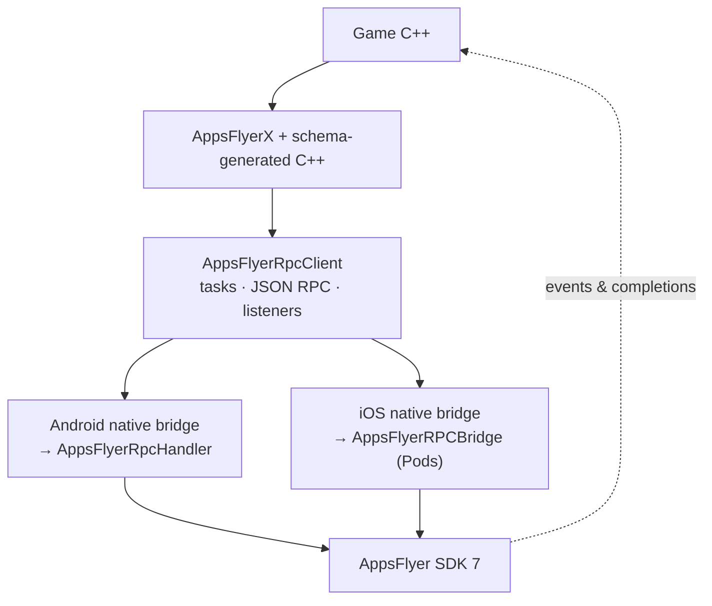
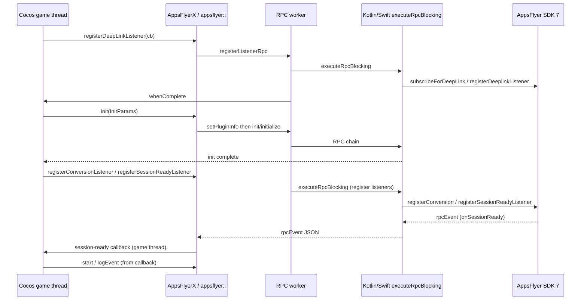
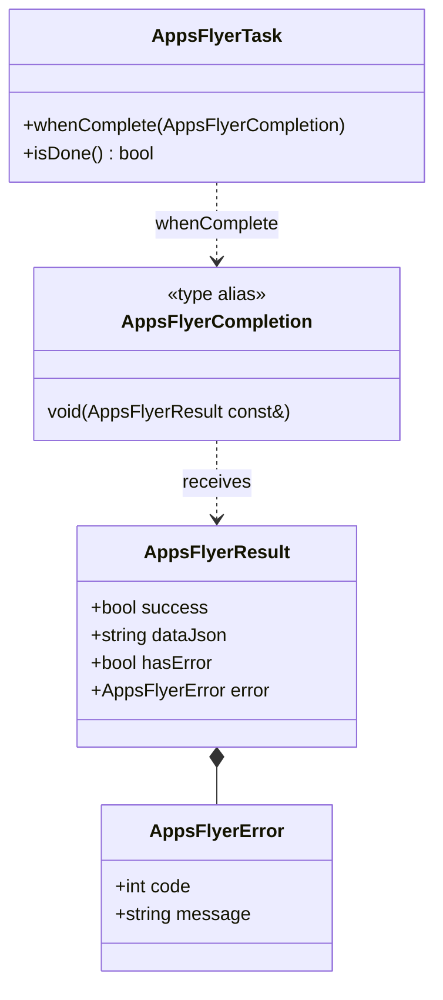

<!-- Paste source for Notion replace_content — synced from PHASE2-TECH-DESIGN.md -->

## Document metadata

| Field | Value |
| --- | --- |
| Document type | Technical design (Phase 2) |
| Epic | [DELIVERY-132096](https://appsflyer.atlassian.net/browse/DELIVERY-132096) |
| Feature branch | `DELIVERY-132096-sdk7-rpc` |
| Phase 2 POC branch | `DELIVERY-132096-sdk7-rpc-phase2-poc` |
| Depends on | <mention url="https://app.notion.com/p/40cb7b13af5f81378541ed80412139fa">Phase 1 — SDK 7 + RPC spine (PR1)</mention> |
| Repo | `appsflyer-cocos2dx-plugin` |
| Source in repo | `internal-docs/PHASE2-TECH-DESIGN.md` |
| Umbrella tech design | <mention url="https://app.notion.com/p/40db7b13af5f80b496d8f302154b2d84">Cocos 2dx SDK7 + RPC Tech design</mention> |
| Closes Phase 1 gap | Phase 1 §8.1 RPC synchronization |

<callout icon="📌" color="blue_bg">
This page is the <b>canonical Phase 2 tech design</b> for stakeholders. Keep in sync with <code>internal-docs/PHASE2-TECH-DESIGN.md</code> when the design changes.
</callout>

---

## 1. Goals

1. Replace Phase 1 hand-maintained RPC / <code>AppsFlyerXCore</code> batching with <b>schema-driven codegen</b> (<code>appsflyer-plugins-rpc-schema.json</code>).
2. Pin the shared RPC schema in-repo and document <b>refresh from Google Artifact Registry (GAR)</b> — <code>schema/rpc-schema.version</code>, committed JSON, <code>scripts/download_rpc_schema_from_gar.sh</code> (<code>AR_TOKEN</code>; CI: <code>appsflyerrnd/setup-ar-auth</code>) before codegen (see §6.1).
3. Ship <b>breaking 7.x</b> public C++ on <code>AppsFlyerX</code> — schema <code>publicApi</code>, <code>AppsFlyerTask</code>, no <code>Rpc</code> in public names.
4. Implement <b>integrator-facing RPC sync</b> (Phase 1 §8.1): immediate listener RPC, game-thread completion, errors, listener rollback.
5. Prove <b>full Cocos public schema surface</b> (79 methods) on sample + headless tests.
6. Still <b>no</b> production RC/release pipeline (Phase 3).

### Success criteria (Phase 2 POC)

| Criterion | Status |
| --- | --- |
| GAR fetch script + pin workflow documented | Done — <code>download_rpc_schema_from_gar.sh</code>, §6.1 |
| C++ codegen (<code>tools/af-schema-compiler</code>) | Done — <b>79</b> public methods |
| <code>AppsFlyerTask</code> / <code>whenComplete</code> on game thread | Done — <code>tests/af-task/</code> |
| Immediate listener RPC + rollback | Done |
| No batched <code>initSdk()</code>; app-owned order | Done — <code>AppDelegate.cpp</code> |
| Internal <code>setPluginInfo</code> before <code>init</code> wire | Done — <code>AppsFlyerRpcClient.cpp</code> |
| Android assemble + JVM tests | Done |
| CI stale-codegen gate | Deferred |
| iOS GAP-010 queue | Deferred |
| <code>doc/migration-guide.md</code> fully aligned | Partial |

---

## 2. Non-goals (Phase 2)

| Item | Deferred to |
| --- | --- |
| RC/release workflows | Phase 3 |
| Cocos Creator / integrator AAR | Phase 3 / separate product |
| macOS legacy <code>libAppsFlyer</code> RPC | Out of scope |
| C++20 coroutines (<code>co_await</code>) | Optional 2.1 |
| JNI-only bridge (drop Kotlin/Swift files) | Future hardening |
| Refresh SDK 6 <code>docs/*README</code> in place | Separate pass |

---

## 3. Background

Phase 1 proved one JSON RPC + <code>rpcEvent</code> on the game thread but batched listeners in <code>initSdk()</code> — not the SDK 7 integrator contract.

Phase 2 uses the shared Maven RPC schema, repo-native C++ codegen, and <b><code>AppsFlyerTask</code></b> so games chain <b>deep link → enableDebug → init → listeners → start</b> like Capacitor/RN. Runtime is C++ only (no in-game JS/npm core).

<b><code>AppsFlyerTask</code></b> is a Promise-like handle from every schema method: outbound JSON RPC runs on a worker thread; optional <code>whenComplete</code> delivers one <code>AppsFlyerResult</code> (or <code>AppsFlyerError</code>) on the <b>game thread</b>. <b>Variant A</b> was selected because Cocos integrators already use callbacks, it matches mobile-plugin synchronization (ordered init, listener rollback), and avoids blocking the game thread or fire-and-forget listener register. Details: §7; full alternatives table in repo <code>PHASE2-TECH-DESIGN.md</code> Appendix A.

---

## 4. Architecture

### 4.1 Phase 1 vs Phase 2 POC

| Phase 1 | Phase 2 POC |
| --- | --- |
| <code>AppsFlyerXCore</code> + manual wires + stubs | Generated <code>appsflyer::</code> + <code>AppsFlyerRpcClient</code> |
| <code>void</code> fire-and-forget | <code>AppsFlyerTask</code> + <code>AppsFlyerCompletion</code> |
| Listeners batched in <code>initSdk()</code> | Immediate <code>register*Listener</code> RPC |
| Handful of RPC methods | <b>79</b> schema methods + listener impl in RpcClient |

### 4.2 Layer diagram



Outbound calls flow <b>down</b>; <code>rpcEvent</code> and <code>whenComplete</code> flow <b>up</b> to the game thread.

<callout icon="ℹ️" color="gray_bg">
Mobile CMake does <b>not</b> link <code>AppsFlyerXAndroid.cpp</code> or SDK 6 <code>AppsFlyerXApple.mm</code>. <code>Classes/Strict/</code> is legacy SDK 6 copy-paste — not SDK 7 Strict pods (use Podfile <code>/Strict</code> subspecs).
</callout>

### 4.3 Design decisions (selected)

| ID | Decision |
| --- | --- |
| D1 | <code>AppsFlyerTask</code> + <code>whenComplete</code> (Variant A — approved) |
| D3 | Codegen: <code>tools/af-schema-compiler</code> → <code>Classes/AppsFlyer/generated/</code> |
| D4 | Two headers: <code>AppsFlyerRpcSchema.generated.*</code> + <code>AppsFlyerXSchemaMethods.generated.h</code> |
| D5 | Single schema param → direct arg; ≥2 params → struct |
| D6 | <code>setPluginInfo</code> internal only (auto before first <code>init</code>) |
| D8 | Listeners: codegen decls; impl in <code>AppsFlyerRpcClient.cpp</code> |
| D9 | <code>manualStart</code> removed from public <code>AppsFlyerX</code> |

Full table: repo <code>PHASE2-TECH-DESIGN.md</code> §4.3.

---

## 5. Call flows

### 5.1 Init sequence (sample)

From <code>Classes/AppDelegate.cpp</code>:

1. Optional schema tasks (e.g. <code>stop</code>, <code>setPartnerData</code>).
2. <code>registerDeepLinkListener</code> → <code>enableDebug(true)</code> → <code>init(InitParams)</code>.
3. <code>registerConversionListener</code> → <code>registerSessionReadyListener</code> → <code>start(false)</code> / <code>logEvent</code>.

<callout icon="⚠️" color="yellow_bg">
App does <b>not</b> call <code>setPluginInfo</code>. Plugin sends internal <code>setPluginInfo</code> immediately <b>before</b> the first <code>init</code> / <code>initialize</code> wire.
</callout>



Inbound <code>onSessionReady</code> (and other listener payloads) are <b>SDK → bridge → <code>rpcEvent</code> → game thread → app callback</b> — not an <code>AppsFlyerTask</code> completion.

### 5.2 Closes Phase 1 §8.1

| Capability | Phase 1 | Phase 2 POC |
| --- | --- | --- |
| Immediate listener registration | Batched in <code>initSdk()</code> | Yes |
| Completion to game | <code>void</code> | <code>AppsFlyerTask</code> |
| Errors to game | Log only | <code>AppsFlyerResult</code> |
| Deep link before init | Docs only | Sample + tests |
| <code>awaitResponse</code> | Fixed false | Schema param (e.g. <code>start(bool)</code>) |

---

## 6. Schema & codegen

| Artifact | Path |
| --- | --- |
| Schema JSON (committed) | <code>schema/appsflyer-plugins-rpc-schema.json</code> |
| Version pin | <code>schema/rpc-schema.version</code> (1.2.0) |
| Fetch from GAR | <code>scripts/download_rpc_schema_from_gar.sh</code> |
| Regenerate C++ | <code>./scripts/codegen/run.sh</code> |

<b>79</b> public Cocos methods (76 RPC + 3 listener pairs). Emitter: <code>tools/af-schema-compiler</code>. CI stale-gen gate: outlined, not wired.

### 6.1 Fetch RPC schema from Google Artifact Registry (GAR)

Shared contract Maven artifact: <code>com.appsflyer.plugins:appsflyer-plugins-rpc-schema</code> on GAR <code>maven-internal</code> (<code>af-artifacts-prd</code>, <code>europe-west1</code>). Game builds use the <b>committed</b> JSON; maintainers refresh when bumping the pin.

<b>Auth:</b> <code>AR_TOKEN</code> (OAuth access token). CI: <code>appsflyerrnd/setup-ar-auth</code>. Local (with registry access): <code>export AR_TOKEN="$(gcloud auth print-access-token)"</code>.

<callout icon="⚠️" color="yellow_bg">
<b>Potential problem:</b> GAR <code>maven-internal</code> is reachable only for identities in the AppsFlyer maintainer setup (typically <code>appsflyerrnd</code> org). Developers outside that org may get auth/403 errors from <code>download_rpc_schema_from_gar.sh</code>.
<b>Mitigation:</b> A maintainer with GAR access runs manual fetch + <code>./scripts/codegen/run.sh</code> on a laptop and commits schema + generated C++ in a PR. Others build from the committed JSON (no GAR). CI automation: §6.5 (deferred).
</callout>

<b>Download pinned version</b> (repo root):

```bash
RPC_SCHEMA_VERSION="$(tr -d '[:space:]' < schema/rpc-schema.version)" \
  ./scripts/download_rpc_schema_from_gar.sh
```

Then verify JSON <code>schemaVersion</code> matches the pin, run <code>./scripts/codegen/run.sh</code>, commit schema + <code>Classes/AppsFlyer/generated/</code>. Optional env: <code>OUTPUT_PATH</code>, <code>RPC_SCHEMA_VERSION=latest</code>, <code>GAR_PROJECT</code>, <code>GAR_LOCATION</code>, <code>GAR_REPOSITORY</code>. Details: repo <code>internal-docs/PHASE2-TECH-DESIGN.md</code> §6.2, <code>schema/README.md</code>.

---

## 7. Await model (<code>AppsFlyerTask</code>)

<b>Variant A (approved):</b> every schema method returns <code>AppsFlyerTask</code>; public names have no <code>Rpc</code> prefix. Optional <code>whenComplete(AppsFlyerCompletion)</code> runs once on the <b>game thread</b> with <code>AppsFlyerResult</code> / <code>AppsFlyerError</code>. Ignoring the task still runs the RPC immediately (no <code>initSdk()</code> batching).

### 7.1 Task model (types)

| Type | Content |
| --- | --- |
| <code>AppsFlyerTask</code> | Public handle; <code>whenComplete</code>, <code>isDone()</code>; holds shared <code>AppsFlyerTaskState</code> |
| <code>AppsFlyerCompletion</code> | Type alias: <code>std::function&lt;void(const AppsFlyerResult&amp;)&gt;</code> |
| <code>AppsFlyerResult</code> | <code>success</code>, <code>dataJson</code>, <code>hasError</code>, <code>error</code> |
| <code>AppsFlyerError</code> | <code>code</code>, <code>message</code> (from native RPC envelope) |



Completions run on the <b>game thread</b> (<code>AppsFlyerCocosThread</code>) when RpcClient <code>finish</code>es the task after outbound RPC. See repo <code>Classes/AppsFlyer/AppsFlyerResult.h</code>, <code>AppsFlyerTask.h</code>.

### 7.2 Execution

Outbound: game → generated API → RPC worker → Kotlin/Swift <code>executeRpcBlocking</code> → native envelope → game-thread <code>whenComplete</code>. Inbound listener events (e.g. <code>onSessionReady</code>): <b>SDK → bridge → <code>rpcEvent</code> → game thread → app callback</b> (§5.1) — not one-shot tasks.

### 7.3 <code>awaitResponse</code>

Schema <code>bool</code> on e.g. <code>start</code> / <code>logEvent</code> / <code>generateInviteLink</code> — controls native blocking/accept semantics; task completes when outbound RPC finishes.

### 7.4 Listener tasks

Register/unregister: snapshot callbacks → native RPC → rollback + failed task on error (Phase 1 §8.1).

### 7.5 Chaining

Sample order: deep link → <code>enableDebug</code> → <code>init</code> → conversion + session-ready → <code>start</code>. Nest <code>whenComplete</code> or schedule next call from the handler. Internal <code>setPluginInfo</code> before first <code>init</code> wire (not public). See <code>AppDelegate.cpp</code>, <code>doc/migration-guide.md</code>.

### 7.6 Alternatives (not selected)

Instead of <code>AppsFlyerTask</code> + optional <code>whenComplete</code> (Variant A — selected):

| Variant | Description | Why not selected |
| --- | --- | --- |
| Sync blocking | Outbound RPC runs on the game thread; call returns when native work finishes | ANR risk and frame hitches on Cocos main loop |
| <code>std::future</code> only | Every schema method returns <code>std::future&lt;AppsFlyerResult&gt;</code> | Heavier for typical callback-style game code; awkward init chaining |
| Completion-only | <code>void</code> methods with trailing <code>AppsFlyerCompletion</code>; no returned task | No task handle for <code>isDone()</code> or shared state; strict subset of Variant A |
| <code>co_await</code> (Phase 2.1) | Coroutine wrapper over the same <code>AppsFlyerTask</code> | Not a different async model—syntax sugar only; deferred |

Repo Appendix A for the full matrix.

---

## 8. Tests & acceptance

Phase 2 is **done** when the tests below exist, run in CI or documented maintainer flow, and **pass** on the Phase 2 PR branch (POC may satisfy only the “Required for POC” rows).

### 8.1 Required automated tests

| Suite | What it proves | How to run | POC |
| --- | --- | --- | --- |
| Headless C++ <code>tests/af-task/</code> | <code>AppsFlyerTask</code> completion on game thread; deep-link register **rollback** on failed RPC; wire order <code>subscribeForDeepLink</code> → internal <code>setPluginInfo</code> → <code>init</code> | <code>./scripts/run-af-task-tests.sh</code> | **Passing** |
| Android JVM <code>BlockingRpcClassificationTest</code> | <code>isBlockingRpc</code> for <code>init</code>, <code>start</code>/<code>logEvent</code> vs <code>awaitResponse</code> | <code>cd proj.android-studio &amp;&amp; ./gradlew :app:testDebugUnitTest</code> | **Passing** |
| Android sample build | SDK 7 RPC + codegen + Kotlin bridge compile and link | <code>./gradlew :app:assembleDebug</code> | **Passing** |

Headless cases (see <code>AppsFlyerTaskTests.cpp</code>): <code>test_task_completes_on_game_thread</code>, <code>test_deep_link_register_rollback_on_failure</code>, <code>test_chain_order_deep_link_before_init</code>.

### 8.2 Required before PR2 merge (not all wired on POC)

| Suite | What it proves | Target |
| --- | --- | --- |
| Schema/codegen parity | Generated Cocos public methods ⊆ schema <code>publicApi</code> for <code>cocos2dx</code> | <code>scripts/verify-schema-codegen.sh</code> (recommended) |
| CI stale-codegen gate | Pin → GAR fetch → <code>codegen/run.sh</code> → clean <code>git diff</code> on <code>Classes/AppsFlyer/generated/</code> | GitHub Actions (§6.5) |
| <code>awaitResponse</code> headless or JVM | Task semantics when <code>start</code>/<code>logEvent</code> use schema <code>awaitResponse: true</code> | Extend <code>tests/af-task/</code> or JVM tests |
| iOS workspace smoke | Cold launch → init chain → session-ready → <code>start</code> on simulator/device | Maintainer checklist (Phase 1 Notion §7) |

### 8.3 Manual / sample (recommended)

- Sample app (<code>AppDelegate.cpp</code>): deep link → <code>enableDebug</code> → <code>init</code> → listeners → <code>start</code> on **Android** (POC exercised) and **iOS** (before merge sign-off).
- No new production RC/release pipeline in Phase 2 (Phase 3).

---

## 9. Open items

- Bridge sign-off: plugin id <code>cocos2dx</code> in internal <code>setPluginInfo</code>
- GAP-010 iOS attribution queue
- Plugin version literal in setPluginInfo vs release semver
- Stale sample <code>Android.mk</code> vs CMake

---

## 10. Approval & PR metadata

- **Target:** <code>DELIVERY-132096-sdk7-rpc</code> ← <code>DELIVERY-132096-sdk7-rpc-phase2-poc</code>
- **Depends on:** Phase 1 merged
- **Blocks:** Phase 3

Approved: Variant A task model, breaking 7.x, immediate listeners, internal <code>setPluginInfo</code>. Pending: PR2 review, bridge sign-off.

---

## Phase 2 POC status

**Branch:** <code>DELIVERY-132096-sdk7-rpc-phase2-poc</code> (push pending)

**Delivered:** Full schema codegen (79 methods), <code>AppsFlyerTask</code>, listener rollback, sample init chain, headless tests, internal <code>setPluginInfo</code>, single-param API rule.

**Deferred:** CI codegen gate, GAP-010, migration/README polish, optional bridge file reduction (JNI → handler / mm → pod).
