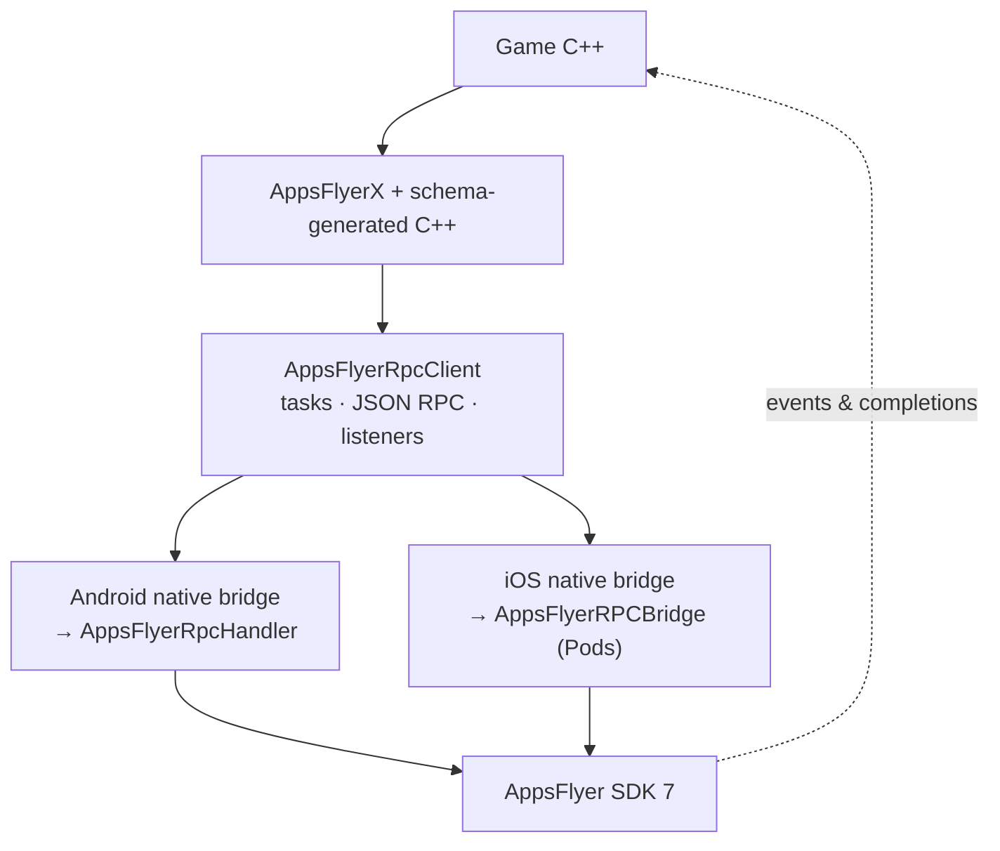
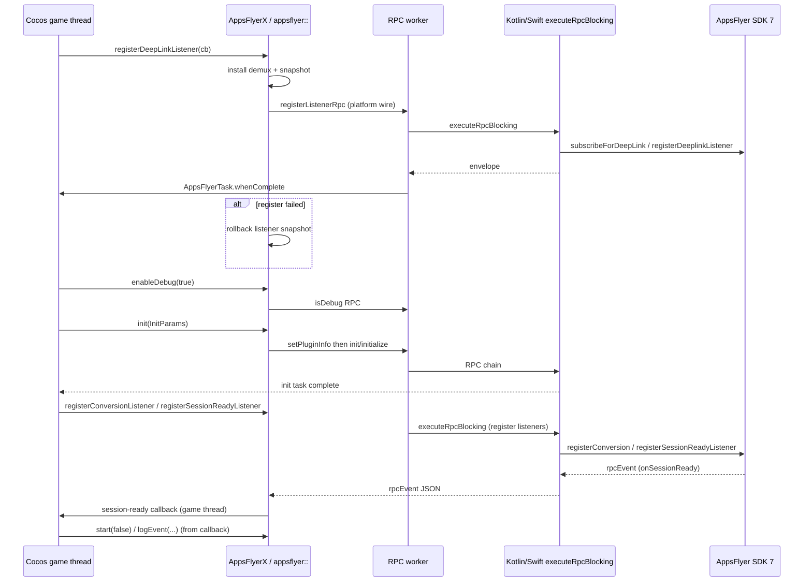
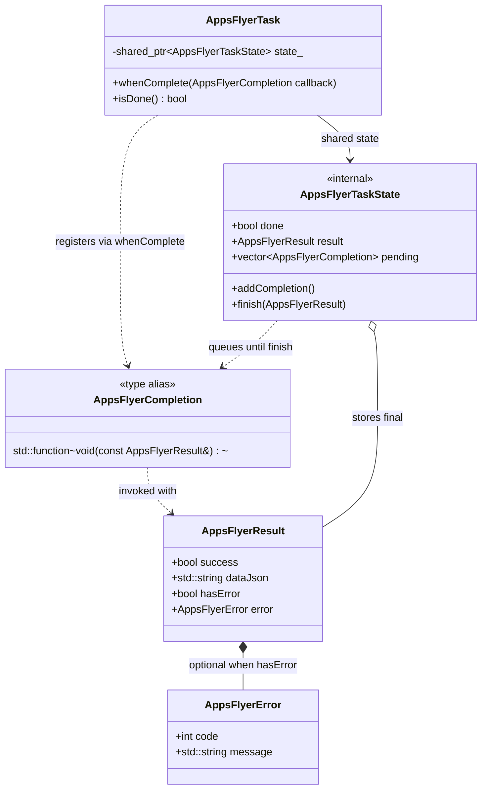

# Tech design — Phase 2: Schema RPC + generated C++ API (PR2)

| Field | Value |
| --- | --- |
| **Document type** | Technical design (Phase 2) |
| **Epic** | [DELIVERY-132096](https://appsflyer.atlassian.net/browse/DELIVERY-132096) |
| **Feature branch** | `DELIVERY-132096-sdk7-rpc` |
| **Phase 2 POC branch** | `DELIVERY-132096-sdk7-rpc-phase2-poc` (push pending) |
| **Depends on** | Phase 1 RPC spine ([`PHASE1-TECH-DESIGN.md`](./PHASE1-TECH-DESIGN.md)) |
| **Status** | **Published to Notion (2026-11-03)** — keep repo + Notion in sync when the design changes; see [Appendix C](#appendix-c--notion-publish-checklist) |
| **Repo** | `appsflyer-cocos2dx-plugin` |
| **Notion (stakeholder copy)** | [Phase 2 — Schema RPC + generated C++ API (PR2)](https://app.notion.com/p/40cb7b13af5f816695dac4fb85c79188) — canonical body §1–10 + POC status (from `PHASE2-NOTION-DRAFT.md`) |
| **Phase 1 gap closed** | [`PHASE1-TECH-DESIGN.md`](./PHASE1-TECH-DESIGN.md) §8.1 |

This document is the **authoritative tech design for Phase 2** (implementation detail + appendices). **[Notion Phase 2](https://app.notion.com/p/40cb7b13af5f816695dac4fb85c79188)** is the **stakeholder source of truth** for §1–10; keep repo §5–§8 aligned when Notion changes.

Supersedes [`PHASE2-SYNC-DESIGN-DRAFT.md`](./PHASE2-SYNC-DESIGN-DRAFT.md) (sync/await decisions only).

---

## 1. Goals

1. Replace hand-maintained RPC wire tables and Phase 1 **`AppsFlyerXCore`** batching with **schema-driven codegen** (`appsflyer-plugins-rpc-schema.json`, `plugins.cocos2dx: public` or default filtering).
2. **Pin** the shared RPC contract in-repo and document **refresh from Google Artifact Registry (GAR)** — `schema/rpc-schema.version`, committed JSON, **`scripts/download_rpc_schema_from_gar.sh`** (`AR_TOKEN`; CI: `appsflyerrnd/setup-ar-auth`) before codegen — see [§6.2](#62-fetch-rpc-schema-from-google-artifact-registry-gar).
3. Ship **breaking 7.x** public C++ API on **`AppsFlyerX`**, aligned to schema **`publicApi`** (task-based, no `Rpc` in public names).
4. Implement **integrator-facing RPC synchronization** from Phase 1 §8.1: immediate per-method native calls, **`AppsFlyerTask`** completion on the **game thread**, errors, listener **rollback**.
5. Prove **full schema surface** for Cocos on the sample app + headless tests (not a hand slice only).
6. Still **no** production RC/release pipeline (**Phase 3**).

### Success criteria (Phase 2 POC — current branch)

| Criterion | Status (POC) |
| --- | --- |
| GAR fetch script + pin workflow documented | Done — `scripts/download_rpc_schema_from_gar.sh`, §6.2, `schema/README.md` |
| C++ codegen from pinned schema (`tools/af-schema-compiler`) | Done — **79** public Cocos methods + 3 listener pairs |
| `AppsFlyerTask` / `whenComplete` on game thread | Done — `tests/af-task/` |
| Listener register/unregister = immediate RPC + rollback | Done |
| No batched `initSdk()`; app-owned order | Done — sample `AppDelegate.cpp` |
| Internal `setPluginInfo` before first `init` wire | Done — `executeRpc` in `AppsFlyerRpcClient.cpp` |
| Android `:app:assembleDebug` + JVM tests | Done |
| CI stale-codegen gate wired in GitHub Actions | **Deferred** (outline in §6.5) |
| iOS GAP-010 cold-start attribution queue | **Deferred** (document interaction only) |
| `doc/migration-guide.md` fully aligned with generated API | **Partial** — refresh before release PR |

---

## 2. Non-goals (Phase 2)

| Item | Deferred to |
| --- | --- |
| Production RC/release workflows, npm-style publishing | Phase 3 |
| Cocos Creator / packaged integrator AAR | Phase 3 / separate product |
| macOS desktop legacy `AppsFlyerXApple.mm` + vendored `libAppsFlyer` RPC path | Out of scope unless requested |
| Mandatory C++20 coroutines (`co_await AppsFlyerTask`) | Optional Phase 2.1 |
| Collapsing Kotlin/Swift bridge into pure C++ JNI → handler (fewer copied files) | Future hardening |
| Replacing `Classes/Strict/` legacy tree or updating SDK 6 public README in place | Separate doc/deprecation pass |

---

## 3. Background

Phase 1 proved **one JSON RPC** per platform (`executeRpcBlocking`) and **`rpcEvent`** demux on the game thread, but kept most `AppsFlyerX` methods as stubs and **batched** listener registration inside **`initSdk()`** — explicitly **not** the SDK 7 integrator contract ([`PHASE1-TECH-DESIGN.md`](./PHASE1-TECH-DESIGN.md) §8.1).

Phase 2 adopts the same **shared RPC schema** as Dart/JS plugins (`@appsflyer-sdk/js-core-plugin` contract source: Maven `appsflyer-plugins-rpc-schema`), emits **C++ dispatch + JSON encoding** from the repo-native compiler, and exposes **`AppsFlyerTask`** so games can chain **deep link → enableDebug → init → conversion/session listeners → start** like Capacitor/RN.

**`AppsFlyerTask` (why it exists):** a small, **Promise-like** handle returned by every generated schema method. It represents outbound work (JSON RPC on a **worker thread**); the game can attach **`whenComplete(AppsFlyerCompletion)`** to receive a single **`AppsFlyerResult`** (success + optional data, or **`AppsFlyerError`**) on the **Cocos game thread**. Completion is **optional** — omitting `whenComplete` does not defer the RPC (unlike Phase 1’s batched `initSdk`), but the app loses a structured success/failure signal.

**Why Variant A was selected** ([Appendix A](#appendix-a--async-api-alternatives-reference)): Cocos games already use **callbacks** on the main/game loop; tasks + `whenComplete` mirror the **integrator synchronization** model from Capacitor/RN (ordered init, listener errors, rollback) without **`std::future`** ergonomics or **C++20 coroutines** as a requirement. **Rejected:** blocking the game thread on RPC (ANR risk), and **fire-and-forget listener register** (cannot report native register failure or roll back callbacks).

**Runtime stack:** C++ game code only — no in-game JavaScript or npm core in the game process.

---

## 4. Architecture

### 4.1 Comparison (Phase 1 vs Phase 2 POC)

| Phase 1 | Phase 2 POC |
| --- | --- |
| `AppsFlyerX` → **`AppsFlyerXCore`** → manual wire table + stubs | `AppsFlyerX` → **generated inline wrappers** → **`namespace appsflyer`** → **`AppsFlyerRpcClient`** |
| `void` / worker fire-and-forget | **`AppsFlyerTask`** + optional **`AppsFlyerCompletion`** |
| Listeners registered inside **`initSdk()`** batch | **Immediate** `register*Listener` RPC when app calls API |
| Hand-maintained init keys (`setAppsFlyerDevKey`, …) on POC path | **`InitParams`** / **`enableDebug(bool)`** schema methods |
| ~handful of RPC methods | **79** codegen methods + 3 listener register/unregister pairs (impl in RpcClient) |

### 4.2 Layer diagram (Phase 2 POC)



Outbound calls flow **down**; **`rpcEvent`** and task **`whenComplete`** callbacks flow **up** to the game thread (dotted).

**Mobile CMake:** does **not** link `AppsFlyerXAndroid.cpp` or SDK 6 **`AppsFlyerXApple.mm`** on **iOS/Android** RPC targets. Legacy files may remain in the repo for reference; **`Classes/Strict/`** is the old Strict **copy-paste** tree (SDK 6), not SDK 7 Strict pods.

**Target spine (future simplification, not implemented):** C++ → JNI → **`AppsFlyerRpcHandler`** (Android) and C++ → **`.mm` → `AppsFlyerRPCBridge`** (iOS) with fewer plugin-owned Kotlin/Swift **files** — same SDK entry points.

### 4.3 Design decisions

| ID | Decision | Rationale |
| --- | --- | --- |
| D1 | **Variant A — `AppsFlyerTask` + `whenComplete`** (approved) | Parity with Dart/JS `Future`/`Promise`; no blocking on game thread |
| D2 | Public API has **no `Rpc` in type or method names** | Transport stays in `appsflyer::executeRpc` / internal headers |
| D3 | Codegen in **`tools/af-schema-compiler`** (C++), not Node js-core emitter | Cocos ships generated `.h/.cpp`; no Node in game build |
| D4 | **Two generated artifacts:** `AppsFlyerRpcSchema.generated.{h,cpp}` + `AppsFlyerXSchemaMethods.generated.h` | `appsflyer::` impl + `.cpp` vs `AppsFlyerX::` inline façade (rename e.g. `fetchAppsFlyerUID` → `getAppsFlyerUID`) |
| D5 | **Param structs only when ≥ 2 fields**; single-param methods take the field directly | e.g. `enableDebug(bool enabled)`, `stop(bool shouldStop)` |
| D6 | **`setPluginInfo` not public** — internal before first **`init`/`initialize`** | Matches Cordova/Capacitor internal plugin metadata; schema `plugins.default: internal` |
| D7 | **Wire JSON keys from schema `mappings`** | e.g. public `enabled` → wire `isDebug` for `enableDebug` |
| D8 | Listeners: **codegen declarations** + **`AppsFlyerRpcClient.cpp` implementations** | Schema `publicApi.callbacks` → `isListener`; demux unchanged on `rpcEvent` |
| D9 | **`manualStart` / `setManualStart` removed** from `AppsFlyerX` | SDK 7 session-ready + `start` contract replaces iOS manual-start flag on public API |
| D10 | iOS build unchanged from Phase 1: **CMake + Podfile + workspace** | [`PHASE1-TECH-DESIGN.md`](./PHASE1-TECH-DESIGN.md) §7.2 |

---

## 5. Call flows

### 5.1 Phase 2 init sequence (POC sample)

Documented in **`Classes/AppDelegate.cpp`**:

1. Optional pre-init calls (`stop`, `setPartnerData`, …) — schema tasks.
2. **`registerDeepLinkListener`** → on success → **`enableDebug(true)`** → **`init(InitParams)`**.
3. On init success → **`registerConversionListener`** → **`registerSessionReadyListener`** (callback calls **`start(false)`** → **`logEvent`**).

**Internal:** RpcClient sends **`setPluginInfo`** (`cocos2dx`, plugin version literal) immediately **before** the first **`init`/`initialize`** wire — app does **not** call `setPluginInfo`.



**Inbound events:** `onSessionReady` (and other listener payloads) flow **SDK → bridge → `rpcEvent` → game thread → app callback** — not an **`AppsFlyerTask`** completion.

### 5.2 Phase 1 §8.1 — capability closure

| Capability | Phase 1 | Phase 2 POC |
| --- | --- | --- |
| Immediate native listener registration | Batched in `initSdk()` | **Yes** — `registerListenerRpc` |
| Completion to game | `void` only | **`AppsFlyerTask` / `AppsFlyerCompletion`** |
| Errors to game | Log only | **`AppsFlyerResult` / `AppsFlyerError`** |
| Deep link before init | Documented only | **Sample + tests enforce chain** |
| `awaitResponse` on start/logEvent | Fixed false | **Schema param** — e.g. `start(bool awaitResponse)` |

---

## 6. Schema workflow & codegen

### 6.1 Artifacts

| Artifact | Path |
| --- | --- |
| RPC schema JSON | `schema/appsflyer-plugins-rpc-schema.json` |
| Version pin | `schema/rpc-schema.version` (**1.2.0**) |
| GAR fetch script | `scripts/download_rpc_schema_from_gar.sh` — see [§6.2](#62-fetch-rpc-schema-from-google-artifact-registry-gar) |
| Codegen driver | `./scripts/codegen/run.sh` (builds `tools/af-schema-compiler`) |

**Builds without GAR access** use the **committed** `schema/appsflyer-plugins-rpc-schema.json` only. Refreshing from GAR is a **maintainer / CI** step when bumping `schema/rpc-schema.version` (not required to compile the POC sample).

### 6.2 Fetch RPC schema from Google Artifact Registry (GAR)

The shared plugin RPC contract is published as a Maven artifact on AppsFlyer **Google Artifact Registry** (`maven-internal`). The repo vendors a copy under `schema/` for offline builds and pins the artifact version in `schema/rpc-schema.version`.

| Item | Value |
| --- | --- |
| Maven coordinates | `com.appsflyer.plugins:appsflyer-plugins-rpc-schema` |
| Artifact file | `appsflyer-plugins-rpc-schema-<version>.json` |
| Default GAR project | `af-artifacts-prd` |
| Default region / repo | `europe-west1` / `maven-internal` |
| Download script | `scripts/download_rpc_schema_from_gar.sh` (adapted from `appsflyer-android-sdk`) |

**Authentication:** the script requires **`AR_TOKEN`** — an OAuth2 access token with read access to the Maven repository. In GitHub Actions, CI obtains this via the **`appsflyerrnd/setup-ar-auth`** action (same pattern as other mobile plugin repos). Locally, maintainers with registry access typically set:

```bash
export AR_TOKEN="$(gcloud auth print-access-token)"
```

**Potential problem:** `maven-internal` on GAR is scoped to AppsFlyer infrastructure (typically the **`appsflyerrnd`** GCP org / maintainer identities). Developers **outside** that org—or without Artifact Registry read on `af-artifacts-prd`—cannot run `download_rpc_schema_from_gar.sh` successfully even with a personal `gcloud` login.

**Mitigation:** A maintainer with GAR access performs **manual fetch + codegen on a laptop** (steps below), then opens a PR that commits the updated **`schema/rpc-schema.version`**, **`schema/appsflyer-plugins-rpc-schema.json`**, and **`Classes/AppsFlyer/generated/`**. Everyone else continues to build from the **committed** schema (no GAR needed). Long term, CI with **`appsflyerrnd/setup-ar-auth`** should automate this (§6.5).

**Environment variables** (all optional except `AR_TOKEN`):

| Variable | Default | Purpose |
| --- | --- | --- |
| `AR_TOKEN` | — | **Required.** Bearer for `oauth2accesstoken:${AR_TOKEN}` basic auth to `*.pkg.dev` |
| `RPC_SCHEMA_VERSION` | `latest` | Semver to download, or `latest` (reads `maven-metadata.xml` `<latest>` / `<release>`) |
| `OUTPUT_PATH` | `schema/appsflyer-plugins-rpc-schema.json` | Destination file |
| `GAR_PROJECT` | `af-artifacts-prd` | GCP project hosting the repo |
| `GAR_LOCATION` | `europe-west1` | Artifact Registry region |
| `GAR_REPOSITORY` | `maven-internal` | Maven repository id |
| `MAVEN_GROUP_ID` | `com.appsflyer.plugins` | Maven group |
| `MAVEN_ARTIFACT_ID` | `appsflyer-plugins-rpc-schema` | Maven artifact id |

**Maintainer workflow** (schema bump — design target; CI gate in §6.5 not wired on POC branch):

1. Set **`schema/rpc-schema.version`** to the Maven version you intend to align with (bridge / js-core schema release).
2. Authenticate (`AR_TOKEN` as above).
3. From repo root, download that version (avoid accidental `latest` drift when pinning):

```bash
RPC_SCHEMA_VERSION="$(tr -d '[:space:]' < schema/rpc-schema.version)" \
  ./scripts/download_rpc_schema_from_gar.sh
```

4. Confirm the JSON **`schemaVersion`** field matches `rpc-schema.version`; commit **`schema/rpc-schema.version`**, **`schema/appsflyer-plugins-rpc-schema.json`**, and regenerated **`Classes/AppsFlyer/generated/`** together.
5. Regenerate C++: `./scripts/codegen/run.sh`, then run `./scripts/run-af-task-tests.sh` and Android assemble.

See also **`schema/README.md`** for the same commands in integrator-facing form.

### 6.3 Emitter rules (`tools/af-schema-compiler`)

- Include methods with `publicApi.delivery: awaitable`, mobile RPC present, and **`plugins.cocos2dx: public`** (or default ≠ `internal` / `none`).
- **Exclude** internal-only methods from **`AppsFlyerX`** (e.g. **`setPluginInfo`**); plugin may still invoke wire internally.
- **Listeners** with `publicApi.callbacks`: emit **`AppsFlyerX`/`.h` declarations**; implement register/unregister in **`AppsFlyerRpcClient.cpp`**.
- **Platform split wire names** in generated `.cpp` (e.g. Android `init` vs iOS `initialize`).
- **Do not** emit separate `AppsFlyerX.generated.cpp` — X methods are **inline** in `AppsFlyerXSchemaMethods.generated.h`.

### 6.4 Method count (POC pin)

| Bucket | Count |
| --- | --- |
| Codegen RPC methods (non-listener) | **76** |
| Listener register/unregister (codegen decl + hand impl) | **3** pairs |
| **Total public task surface** | **79** |

Regenerate after schema bump: `./scripts/codegen/run.sh`.

### 6.5 CI stale-gen gate (outline — not wired)

1. `appsflyerrnd/setup-ar-auth` (sets `AR_TOKEN`) → `./scripts/download_rpc_schema_from_gar.sh` with `RPC_SCHEMA_VERSION` from `schema/rpc-schema.version`
2. `./scripts/codegen/run.sh`
3. `git diff --exit-code` on `Classes/AppsFlyer/generated/`
4. `./scripts/run-af-task-tests.sh` + Android assemble (existing workflows)

---

## 7. Await model (`AppsFlyerTask`)

Full variant analysis: [Appendix A](#appendix-a--async-api-alternatives-reference). **Variant A** — `AppsFlyerTask` + `whenComplete` — is approved for Phase 2. Public API uses **task** naming only (no `Rpc` in type or method names); transport stays inside **`AppsFlyerRpcClient`**.

### 7.1 Types

| Type | Role |
| --- | --- |
| **`AppsFlyerTask`** | Returned by every schema RPC method; shared state for one outbound operation |
| **`AppsFlyerCompletion`** | `std::function<void(const AppsFlyerResult&)>` — optional; invoked **at most once** |
| **`AppsFlyerResult`** | `success`, optional payload string, optional **`AppsFlyerError`** (code + message from native envelope) |
| **`AppsFlyerTaskState`** | Internal; holds completion queue + done flag (see `AppsFlyerTask.h` / `.cpp`) |

Sources: `Classes/AppsFlyer/AppsFlyerTask.h`, `AppsFlyerResult.h`, `AppsFlyerTaskState.h`.

**Model (public + internal):**



RpcClient calls **`AppsFlyerTaskState::finish(result)`** on the game thread after parsing the native envelope; **`whenComplete`** registered before **`finish`** runs once with that **`AppsFlyerResult`**.

### 7.2 App-facing API

```cpp
AppsFlyerTask task = AppsFlyerX::init(params);
task.whenComplete([](const AppsFlyerResult& result) {
    if (!result.success) { /* handle AppsFlyerError */ return; }
    // safe to touch Cocos nodes / schedule next RPC
});
```

- **`whenComplete`** may be called from the game thread when the app invokes the generated method; the **callback always runs on the game thread** (`AppsFlyerCocosThread`), even if the RPC already finished on the worker.
- **`isDone()`** — poll helper; prefer completions for init chains.
- Ignoring the returned **`AppsFlyerTask`** still **schedules the RPC immediately** on the worker (Phase 2 does not batch listener wires into `initSdk`).

### 7.3 Execution path

1. Game calls **`AppsFlyerX`** / generated **`appsflyer::`** method → returns **`AppsFlyerTask`**.
2. **`AppsFlyerRpcClient`** posts work to the **RPC worker** → **`executeRpcBlocking`** on Kotlin/Swift bridge → native SDK.
3. Envelope `{ success, data \| error }` parsed → **`AppsFlyerResult`** built.
4. Worker hops to **game thread** → run registered **`AppsFlyerCompletion`**(s) for that task.

**Inbound** listener events (e.g. **`onSessionReady`**): **SDK → bridge → `rpcEvent` → game thread → app callback** (see §5.1). Not **`AppsFlyerTask`** completions.

### 7.4 `awaitResponse` (schema param)

Methods such as **`start`**, **`logEvent`**, **`generateInviteLink`** expose schema **`awaitResponse`** (often a single `bool` on the public API). It is encoded in JSON and affects how long the native side blocks before accepting the call vs waiting for a round-trip. The **`AppsFlyerTask`** still completes on the game thread when the outbound RPC finishes; the param controls **native** behavior (Android **`isBlockingRpc`** classification unchanged from Phase 1).

### 7.5 Listener registration tasks

`register*Listener` / `unregister*` return **`AppsFlyerTask`** as well:

1. **Snapshot** prior callback state for the affected event type(s).
2. Install new callback in the demux registry.
3. Issue **immediate** native register/unregister RPC on the worker.
4. On failure: **restore** snapshot, complete task with **`AppsFlyerError`**.
5. On success: keep new callbacks; task completes success.

This closes Phase 1 §8.1 (“errors back to the game” + “immediate listener RPC”).

### 7.6 Chaining init order

Recommended SDK 7 order (sample: **`Classes/AppDelegate.cpp`**):

**deep link listener → `enableDebug` → `init` → conversion + session-ready listeners → `start` / `logEvent`**

Use nested **`whenComplete`** (or schedule the next call from the completion handler) so each step runs after the previous RPC succeeds. Internal **`setPluginInfo`** is **not** on `AppsFlyerX`; RpcClient sends it on the wire immediately before the first **`init`/`initialize`**.

More examples: **`doc/migration-guide.md`**.

### 7.7 Alternatives (not selected)

Instead of **`AppsFlyerTask`** + optional **`whenComplete`** (Variant A — selected):

| Variant | Description | Why not selected |
| --- | --- | --- |
| Sync blocking | Outbound RPC on the game thread; call returns when native work finishes | ANR risk and frame hitches on the Cocos main loop |
| **`std::future` only** | Every schema method returns `std::future<AppsFlyerResult>` | Heavier for typical callback-style game code; awkward init chaining |
| Completion-only | `void` methods with trailing `AppsFlyerCompletion`; no returned task | No task handle for `isDone()` or shared state; strict subset of Variant A |
| **`co_await`** (Phase 2.1) | Coroutine wrapper over the same `AppsFlyerTask` | Not a different async model—syntax sugar only; deferred |

Full matrix: [Appendix A](#appendix-a--async-api-alternatives-reference).

---

## 8. Documentation & migration

| Doc | Purpose | POC status |
| --- | --- | --- |
| **`doc/migration-guide.md`** | 6.x → 7.x breaking changes, init chain | Needs refresh (remove stale `initSdk`/setter examples; document `enableDebug`, internal `setPluginInfo`, single-param API) |
| **`schema/README.md`** | Schema pin, codegen, 79 methods, internal `setPluginInfo` | Updated on POC branch |
| **`docs/iOS_README.md`**, **`docs/Android_README.md`** | Legacy SDK 6 copy lists | **Stale** — point to SDK 7 integration doc when published |
| Sample | **`Classes/AppDelegate.cpp`**, **`HelloWorldScene.cpp`** | Schema task API |

README: plugin version, Android bridge/BOM pins, iOS pod pins, **schema version**.

---

## 9. Tests & acceptance

Phase 2 is **done** when the tests below exist, run in CI or a documented maintainer flow, and **pass** on the Phase 2 PR branch (the POC branch may satisfy only the “Required for POC” rows).

### 9.1 Required automated tests

| Suite | What it proves | How to run | POC |
| --- | --- | --- | --- |
| Headless C++ **`tests/af-task/`** | **`AppsFlyerTask`** completion on game thread; deep-link register **rollback** on failed RPC; wire order `subscribeForDeepLink` → internal **`setPluginInfo`** → **`init`** | `./scripts/run-af-task-tests.sh` | **Passing** |
| Android JVM **`BlockingRpcClassificationTest`** | **`isBlockingRpc`** for `init`, `start` / `logEvent` vs **`awaitResponse`** | `cd proj.android-studio && ./gradlew :app:testDebugUnitTest` | **Passing** |
| Android sample build | SDK 7 RPC + codegen + Kotlin bridge compile and link | `./gradlew :app:assembleDebug` | **Passing** |

Headless cases (`AppsFlyerTaskTests.cpp`): `test_task_completes_on_game_thread`, `test_deep_link_register_rollback_on_failure`, `test_chain_order_deep_link_before_init`. Transport stubs: **`AF_RPC_HEADLESS_TEST`** in `AppsFlyerRpcClient.cpp`.

### 9.2 Required before PR2 merge (not all wired on POC)

| Suite | What it proves | Target |
| --- | --- | --- |
| Schema/codegen parity | Generated Cocos public methods ⊆ schema **`publicApi`** for `cocos2dx` | `scripts/verify-schema-codegen.sh` (recommended) |
| CI stale-codegen gate | Pin → GAR fetch → `codegen/run.sh` → clean **`git diff`** on `Classes/AppsFlyer/generated/` | GitHub Actions (§6.5) |
| **`awaitResponse`** tests | Task/native blocking behavior when `start` / `logEvent` use schema **`awaitResponse: true`** | Extend `tests/af-task/` or JVM tests |
| iOS workspace smoke | Cold launch → init chain → session-ready → **`start`** on simulator/device | Maintainer checklist ([`PHASE1-TECH-DESIGN.md`](./PHASE1-TECH-DESIGN.md) §7) |

### 9.3 Manual / sample (recommended)

- Sample app (**`Classes/AppDelegate.cpp`**): deep link → **`enableDebug`** → **`init`** → listeners → **`start`** on **Android** (POC exercised) and **iOS** (before merge sign-off).
- Implementation gates (not test suites): legacy **`AppsFlyerXCore`** / hand-RPC matrix removed; **79** schema codegen methods; Kotlin/Swift generic **`executeRpcBlocking`** retained; **`doc/migration-guide.md`** aligned before release PR.

Threading and errors for tasks and **`rpcEvent`**: §7 and Phase 1 Notion §8 — not repeated here.

---

## 10. Open questions / risks

| ID | Topic | Status |
| --- | --- | --- |
| Bridge | Plugin id **`cocos2dx`** in internal **`setPluginInfo`** — bridge enum sign-off | Open (carried from Phase 1) |
| GAP-010 | iOS attribution / deep-link queue before bridge ready | Document; full port follow-up |
| Version | Plugin version literal in **`setPluginInfo`** JSON (`7.0.0-poc`) vs release semver | Tie to Phase 3 versioning |
| Android packaging | Extract RPC Kotlin to reusable module / document CMake-only vs stale **Android.mk** | Follow-up |
| Strict mode | Document Podfile + AD_ID only (no `Classes/Strict` for SDK 7) | Doc task |
| Future | JNI → **`AppsFlyerRpcHandler`** / `.mm` → **`AppsFlyerRPCBridge`** to reduce copied bridge files | Design option — §4.2 |

---

## Appendix A — Async API alternatives (reference)

| Variant | Sketch | Phase 2 |
| --- | --- | --- |
| **A — `AppsFlyerTask` + `whenComplete`** | `.whenComplete([](AppsFlyerResult r){...})` | **Selected** |
| **B — Completion-only** | `void init(p, AppsFlyerCompletion cb)` | Subset of A |
| **C — `std::future<AppsFlyerResult>`** | internal async only | Tests/tools |
| **D — C++20 coroutines** | `co_await AppsFlyerTask` | Optional 2.1 |
| **E — Sync blocking public API** | blocking on game thread | **Rejected** |
| **F — Phase 1 batch `initSdk`** | void setters + batched worker | Phase 1 only |
| **G — Fire-and-forget listeners (Unity-style)** | return before envelope | **Rejected** for register |

---

## Appendix B — Approval record

Design decisions approved for implementation (await model + breaking 7.x + immediate listeners):

- [x] **Variant A** — `AppsFlyerTask` + `whenComplete` (**no `Rpc` in public names**)
- [x] **Breaking 7.x** naming aligned to schema where generated
- [x] **Immediate** listener RPC; rollback on failure
- [x] **Internal `setPluginInfo`**; not on `AppsFlyerX`
- [ ] **POC → PR2** sign-off after branch push + reviewer pass
- [ ] Bridge/SDK sign-off on **`setPluginInfo`** / plugin id **`cocos2dx`**

---

## Appendix C — Notion publish checklist

**Published 2026-11-03** via `replace_content` from `internal-docs/PHASE2-NOTION-DRAFT.md`.

- [x] Replace Notion Phase 2 body with sections **1–10** + POC status (appendices repo-only)
- [x] Update Notion **Phase 2 POC status** block (removed outdated `appsflyer::sdk7`, `tests/sdk7/`, “hand slice only”)
- [x] Refresh mermaid **§4.2** + **§5.1** on Notion
- [ ] Link **Phase 2 POC branch** and PR when opened
- [x] Repo doc status → “Published to Notion; keep in sync” (Notion page has no separate Status property)
- [ ] Confirm umbrella page [Cocos 2dx SDK7 + RPC Tech design](https://app.notion.com/p/40db7b13af5f80b496d8f302154b2d84) links to updated Phase 2

**Draft summary for Notion (post-approval one-liner):** Phase 2 delivers schema codegen (**79** methods), **`AppsFlyerTask`** sync, full listener model, internal **`setPluginInfo`**, sample + headless tests; CI codegen gate and iOS GAP-010 remain follow-ups before PR2 merge.
